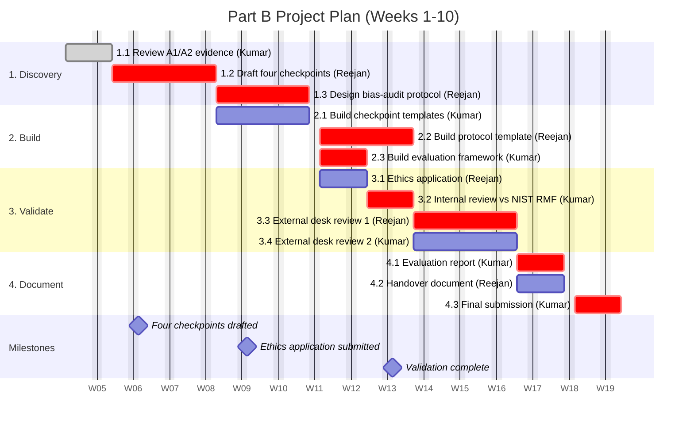

# AI Governance Implementation Pathway

**A four-checkpoint governance pathway for agentic AI in Australian IT project management.**

## The problem

Australian IT project managers are deploying AI agents faster than they can govern them. Gartner forecasts that more than 40% of agentic AI projects will be canceled by 2027 due to escalating costs, unclear business value, or inadequate risk controls (Gartner, 2025). Only 21% of companies surveyed globally have a mature governance model for AI agents (Deloitte, 2026).

## The evidence

- No standard reference architecture exists for governing enterprise AI agents (Venkiteela, 2026).
- Existing governance frameworks are structurally insufficient for agentic AI (Venkiteela, 2026).
- Abstract guidelines lack operational specificity (Kladko et al., 2026).

## The solution

A four-checkpoint pathway aligned to NIST AI RMF:

1. **Govern** — accountability roles defined
2. **Map** — decision points documented
3. **Measure** — bias and accuracy metrics
4. **Manage** — review and correction process

## Project plan

See the [Project Board](https://github.com/kumarbhandari600-sudo/ai-governance-pathway/projects).

**Part B milestones:**
- Week 8: Four checkpoints defined
- Week 10: Bias-audit protocol documented and validation complete

### Project Schedule

